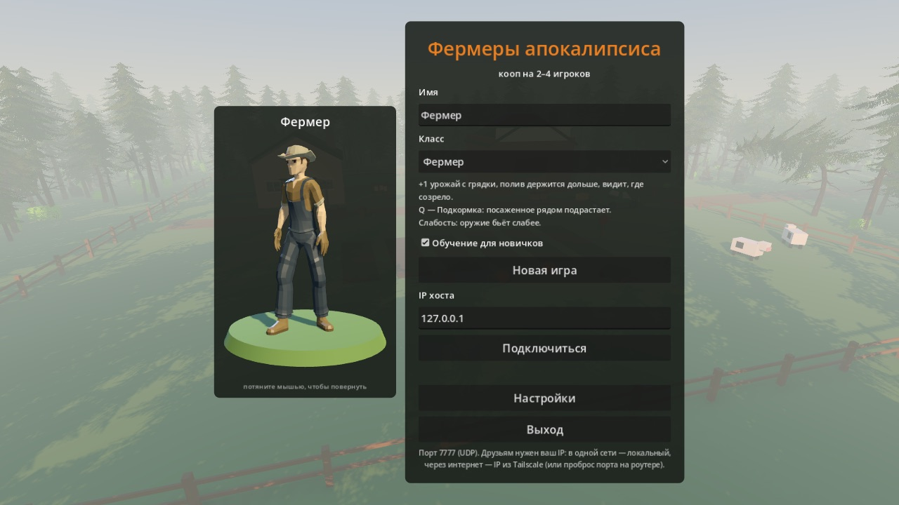
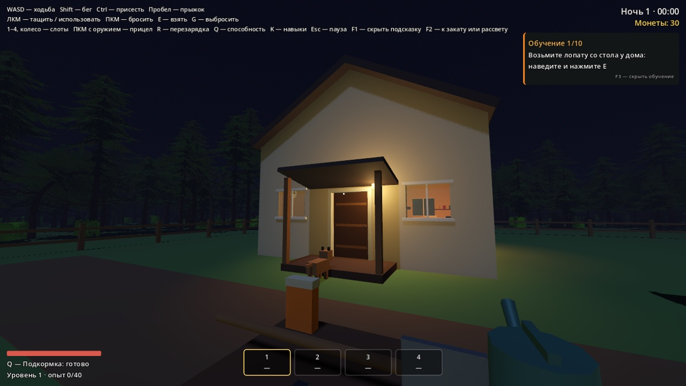
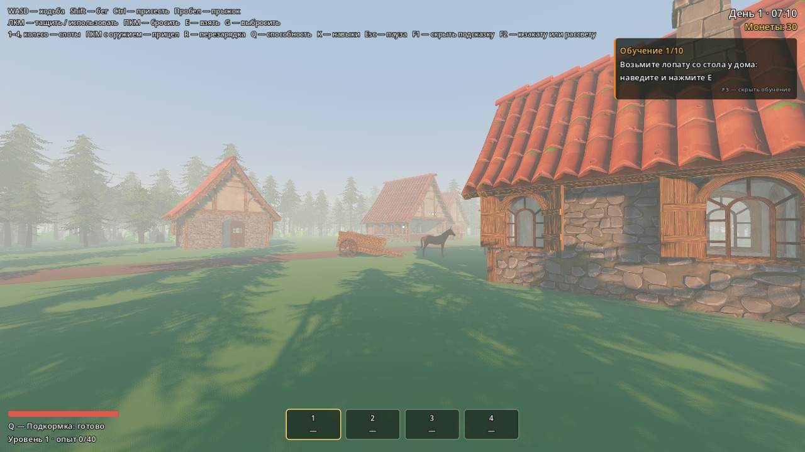
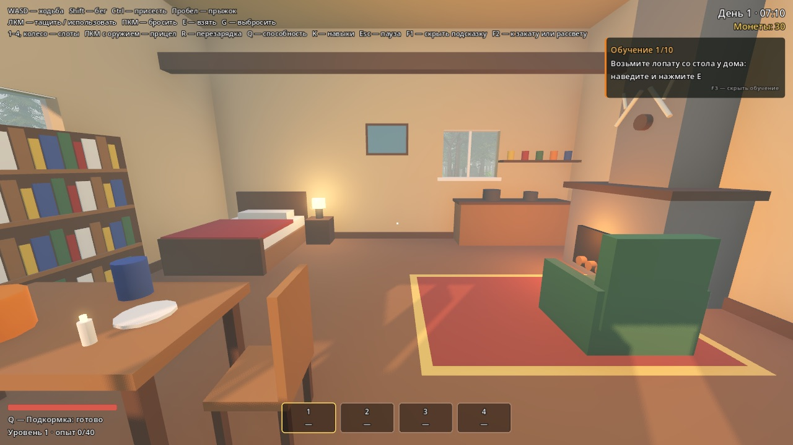
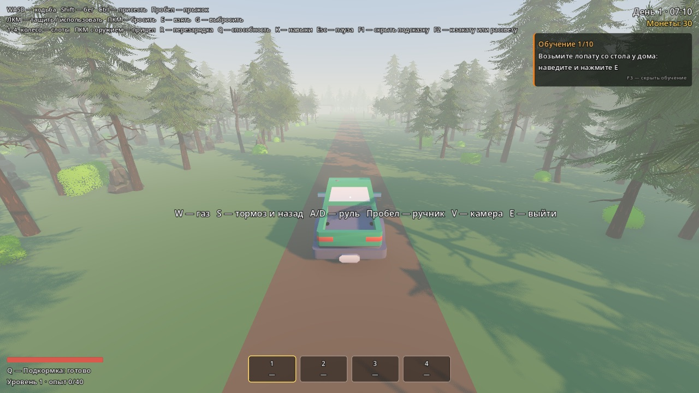
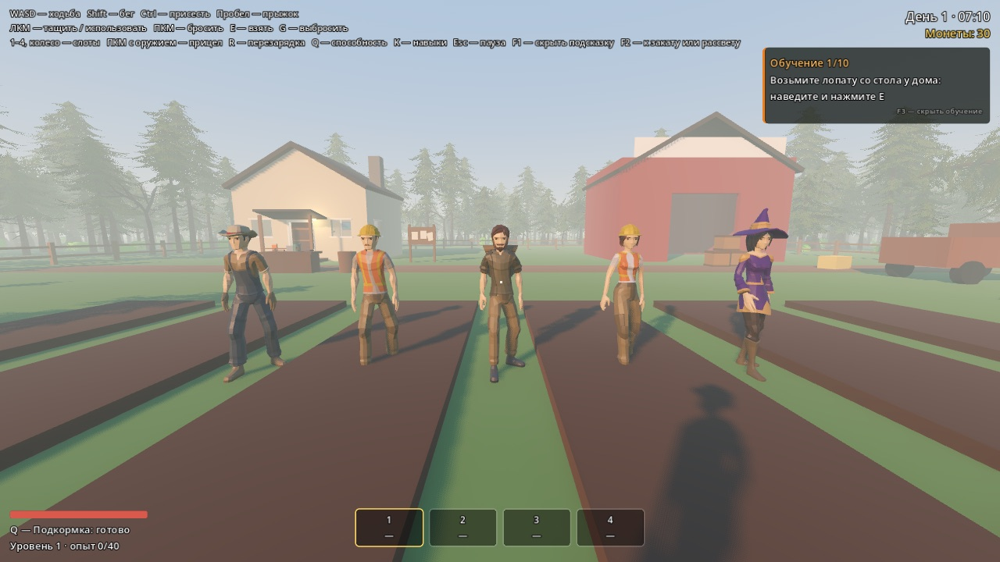
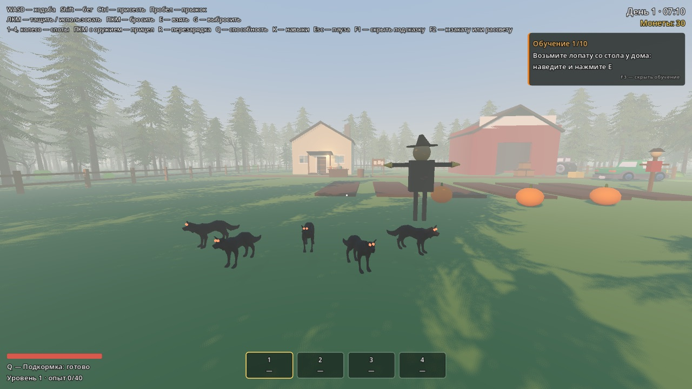
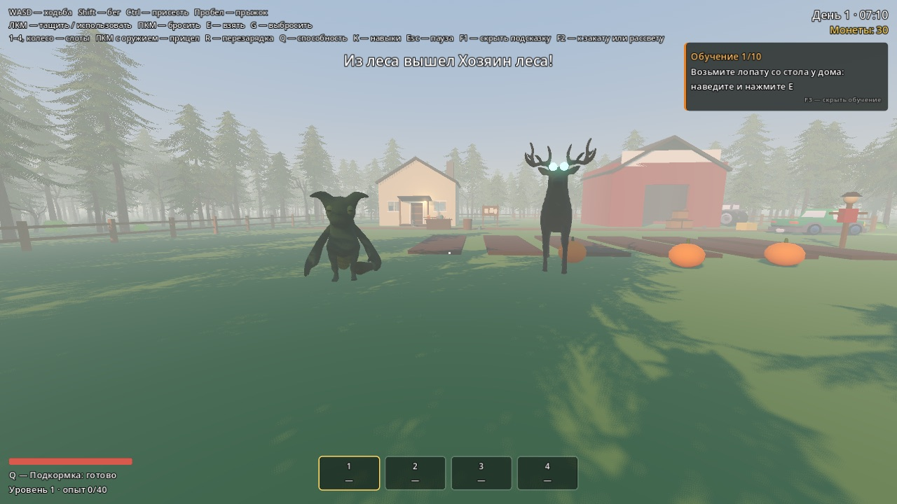

<div align="center">

# 🎃 Фермеры апокалипсиса

**Кооперативная ферма на 2–4 игроков: днём растим урожай, ночью отбиваемся от тварей из леса.**

Уютно днём, жутко ночью — в духе PEAK, R.E.P.O. и Lethal Company.

[**⬇ Скачать последнюю версию**](../../releases/latest) · macOS · Windows



</div>

## Об игре

Вы с друзьями — фермеры на опушке тёмного леса. Днём копаете грядки, поливаете, доите коров, возите урожай на пикапе в деревню и покупаете оружие у торговца. Когда солнце садится, из леса выходят существа: кто-то ворует урожай, кто-то ломает забор, а кто-то охотится на вас самих.

Выживайте ночь за ночью, прокачивайте ферму и свой класс — и не теряйте друг друга из виду.

| | |
|---|---|
|  |  |
|  |  |

## Что есть в игре

- **Ферма**: грядки (вскопать, посадить, полить, собрать), коровы, сторожевая собака, общие улучшения фермы.
- **Пикап** с заносом на ручнике, местами в кузове и видом от третьего лица.
- **Деревня**: скупка урожая и лавка с инструментами, оружием и патронами.
- **Физика в стиле R.E.P.O.**: таскать ящики и тыквы вдвоём, кидать, ставить пугало, пинать тела монстров, кувыркаться от удара.
- **Пять классов** со своими способностями и деревьями навыков.
- **Смена дня и ночи**, атмосферные звуки леса, жуткие голоса из чащи.
- **Сохранения** и переподключение после вылета — прогресс игрока сохраняется по имени.
- **Обучение** для новичков и полные настройки графики, звука и управления.

## Классы



| Класс | Сильная сторона | Способность (Q) |
|---|---|---|
| 🌾 **Фермер** | +1 урожай, видит, где созрело | Подкормка: посаженное рядом подрастает |
| 🔧 **Механик** | Чинит забор целиком, инструменты дешевле | Быстрый ремонт всего забора рядом |
| 🎯 **Охотник** | Бьёт сильнее, видит существ сквозь туман | Выследить: существа подсвечены для всех |
| 🐄 **Скотник** | Коровы слушаются, молока вдвое больше | Свист: коровы идут за вами |
| 🌿 **Травник** | Продаёт на 30% дороже | Дым: существа рядом в ужасе убегают |

## Существа

| | |
|---|---|
|  |  |

- **Грядочник** — ворует урожай и грызёт забор. Боится света фонаря.
- **Таран** — лось из коряг, ломает забор и бросается на игроков. Слабость — капкан.
- **Рой** — стая тёмных волчат: каждый падает с одного удара, но их много.
- **Пугальщик** — стоит как вкопанный, пока на него смотрят. Отвернулись — он уже рядом.
- **Кукурузник** — хватает игрока и тащит в лес. Отбить может только товарищ.
- **Хозяин леса** — босс редких ночей: топчет, ломает забор, зовёт стаю.

## Как играть вместе

1. Один игрок нажимает **«Новая игра»** — он хост.
2. Остальные вводят IP хоста и жмут **«Подключиться»**.
3. Порт **7777 (UDP)**.
   - В одной сети (дома, по Wi-Fi) — локальный IP хоста.
   - Через интернет проще всего [Tailscale](https://tailscale.com): все ставят его, хост сообщает свой IP вида `100.x.x.x`. Либо пробросьте порт 7777 на роутере хоста.

## Управление

| Клавиша | Действие |
|---|---|
| WASD, Shift, Ctrl, Пробел | ходьба, бег, присесть, прыжок |
| ЛКМ | использовать предмет / ударить / тащить |
| ПКМ | бросить то, что тащите; прицелиться из оружия |
| Колесо, R | повернуть предмет в руках, поставить ровно |
| E / G | взять / выбросить |
| 1–4, колесо | слоты инвентаря |
| Q | способность класса |
| K | навыки |
| R | перезарядка |
| V | вид от третьего лица в пикапе |
| F1 / F3 / F11 | подсказки / обучение / полный экран |
| Esc | пауза и настройки |

## Установка

**macOS** (Apple Silicon и Intel): распакуйте архив и перетащите игру в «Программы». Сборка не подписана сертификатом Apple, поэтому при первом запуске откройте её **правой кнопкой → «Открыть» → «Открыть»**. Если macOS всё равно не даёт, в «Системные настройки → Конфиденциальность и безопасность» нажмите «Всё равно открыть».

**Windows**: распакуйте архив и запустите `FarmersOfTheApocalypse.exe`. Если появится синее окно SmartScreen — «Подробнее» → «Выполнить в любом случае».

Если игра тормозит: **Настройки → Качество графики → Низкое**, и при необходимости уменьшите «Масштаб отрисовки» до 75%.

## Для разработчиков

Игра сделана на [Godot 4.7](https://godotengine.org) (GDScript, Jolt Physics). Откройте папку в Godot и нажмите F5.

Автотесты без окна:

```bash
godot --headless --path . --script tests/smoke_test.gd
```

Дизайн и все принятые решения — в [DESIGN.md](DESIGN.md).

## Авторы ассетов

Модели — Quaternius и Kenney, звуки — Meta Open Sound, SFX Kit и Kenney, все под лицензией CC0. Подробно — в [assets/CREDITS.md](assets/CREDITS.md). Спасибо им!
